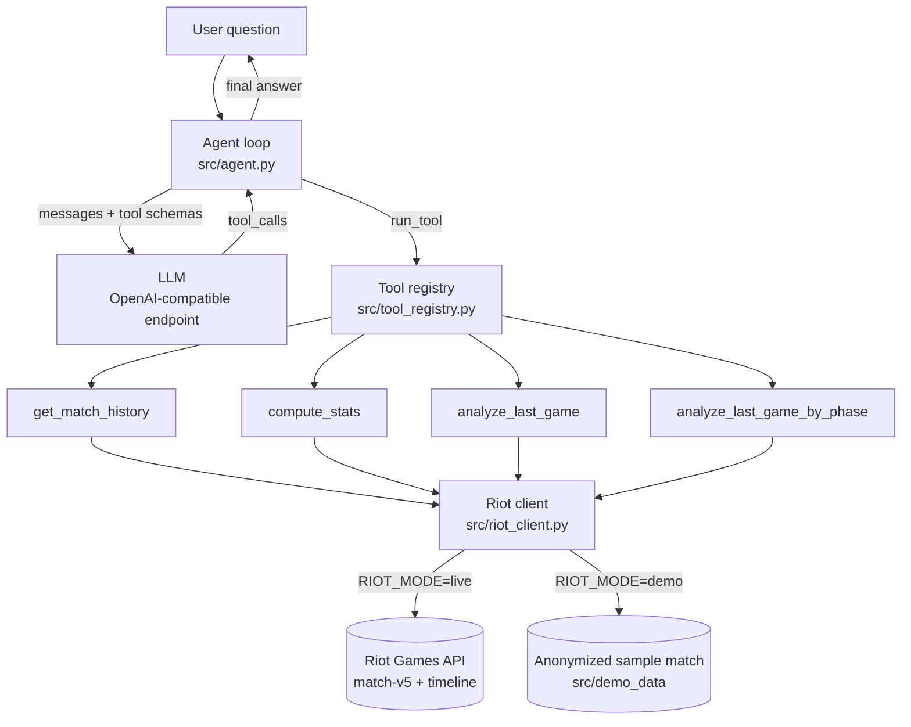

# LoL Agent Coach

A conversational agent that analyzes your League of Legends games and gives
you a personalized diagnosis by combining several data sources through a
**hand-written function-calling loop** (no LangChain/CrewAI: the goal is to
understand every building block).

> _"Was I ahead of my lane opponent at 10 minutes?"_ — the agent decides on its
> own which tools to call, in which order, then answers with real numbers.

## Try it in 3 minutes

No Riot key needed: **demo mode** (the default) analyzes an anonymized sample
match. You only need an LLM key (free or not),
which you paste in the app's sidebar.

**With Docker**

```bash
docker compose up --build
```

Open http://localhost:8501, paste your LLM key in the sidebar, click a sample question.

**Without Docker**

```bash
python -m venv venv
venv\Scripts\activate          # Windows
# source venv/bin/activate     # macOS / Linux
pip install -r requirements.txt
streamlit run app.py
```

Two modes, selected with `RIOT_MODE`:

| Mode             | Data                                                              | Needs                                |
| ---------------- | ----------------------------------------------------------------- | ------------------------------------ |
| `demo` (default) | One anonymized sample match, replayed from disk, no network       | An LLM key                           |
| `live`           | Your real latest Solo/Duo games through the Riot API              | `RIOT_API_KEY` (expires every 24h) and an LLM key |

## Why

Players have access to a huge amount of raw stats (op.gg, u.gg) but little
contextual analysis. This agent turns raw match data into an actionable,
natural-language diagnosis, grounded in the Riot Games API.

## Architecture



The Riot client is the single seam between the tools and the data: the live
and demo sources satisfy the same interface, so the four tools never know which
one is active.

| Module                        | Role                                                                                          |
| ----------------------------- | --------------------------------------------------------------------------------------------- |
| `src/agent.py`                | Agent loop, system prompt, LLM call, anti-hallucination guardrail                             |
| `src/tool_registry.py`        | Single definition of each tool (description + function); derives the function-calling schemas |
| `src/riot_client.py`          | Data sources (live API with retry and disk cache, or demo replay) behind `get_match_history` and `get_last_match` |
| `src/tools/stats.py`          | Pure aggregation of match history (no network)                                                |
| `src/tools/last_game.py`      | Quick diagnosis of the latest game                                                            |
| `src/tools/phase_analysis.py` | Phase-by-phase breakdown and milestones of the latest game, from the timeline                 |
| `src/limits.py`               | Per-session limits for the public demo                                                        |
| `app.py`                      | Streamlit chat interface                                                                      |

## The agent loop

1. The user asks a question.
2. The LLM receives the question plus the list of tools (name, description, parameters).
3. It answers either with final text or with a tool call request (`tool_calls`).
4. For a tool call, Python runs it and sends the result back as a `role: "tool"` message.
5. Repeat until the LLM gives a final answer (capped at 6 steps).

A guardrail checks the final answer for details the tools never provide
(spells Q/W/E/R, wards) and asks the model to redo it once if it finds any.

## The 4 tools

| Tool                         | What it does                                                                                                                                                                                                                                                                                         | Code                          |
| ---------------------------- | ---------------------------------------------------------------------------------------------------------------------------------------------------------------------------------------------------------------------------------------------------------------------------------------------------- | ----------------------------- |
| `get_match_history`          | Last N games; for each: the player, the direct opponent (same role, opposing team) and all 10 players                                                                                                                                                                                                | `src/riot_client.py`          |
| `compute_stats`              | Aggregates several games: winrate, average KDA, CS/min, per-champion stats, average gap versus direct opponents, the 3 worst games with likely reasons                                                                                                                                               | `src/tools/stats.py`          |
| `analyze_last_game`          | Quick diagnosis of the very last game (result, KDA, gold/CS gap against the direct opponent)                                                                                                                                                                                                         | `src/tools/last_game.py`      |
| `analyze_last_game_by_phase` | Splits the last game into 5 phases (laning 0-10, early 10-14, mid 14-25, late 25-30, ultra_late 30+ min) with kills/deaths/assists/gold per player, milestones (CS, gold and level at 10/15/20 min against the direct opponent), plus every kill/death of the player (timestamp, approximate zone, nearby kills within 15s to tell a skirmish from a 1v1) | `src/tools/phase_analysis.py` |

Only Solo/Duo games (queue 420) are analyzed in live mode; remakes are excluded
from the history.

## Configuration

Copy `.env.example` to `.env` and fill in what you need (the file is git-ignored
and excluded from the Docker image):

```
RIOT_MODE=demo            # demo | live
RIOT_API_KEY=             # live mode only: https://developer.riotgames.com (expires every 24h)
LLM_API_KEY=              # optional in the web app: visitors can paste their own key
# LLM_URL=https://generativelanguage.googleapis.com/v1beta/openai/chat/completions
# LLM_MODEL=gemini-2.5-flash
# RIOT_REGIONAL=europe    # europe | americas | asia
```

The LLM provider is interchangeable: any OpenAI-compatible endpoint (Gemini,
Groq, Cohere, ...) works by changing these variables, without touching the code.

An LLM key typed in the sidebar is kept only in the browser session: it is sent
to the LLM provider and never stored or logged.

## Usage

Web interface (demo or live, depending on `RIOT_MODE`):

```bash
streamlit run app.py
```

Terminal:

```bash
python src/agent.py "YourName" "TAG"
```

In live mode, run it with your Riot ID. In demo mode the name is ignored.
The agent answers in the language of your question. Type `quit` to exit.

**Live demo at an interview:** set `RIOT_MODE=live` and a fresh `RIOT_API_KEY`
in `.env`, then `docker compose up` or `streamlit run app.py`.

## Docker

```bash
docker compose up --build        # demo mode by default
RIOT_MODE=live docker compose up # reads RIOT_API_KEY / LLM_API_KEY from .env
```

The image holds no secret, runs as a non-root user, exposes a health check
(`/_stcore/health`), and pins its dependencies. `.dockerignore` keeps `.env`,
the local cache, tests and virtual environments out of the build.

## Hosting a public link

Deploy `app.py` on Streamlit Community Cloud (no Docker needed) **in demo
mode only**: a Riot dev key must not power a public service (it expires every
24h and is not meant for public apps). Visitors bring their own LLM key. Each
session is limited to 20 questions of 500 characters.

## Tests

```bash
pip install -r requirements-dev.txt
pytest tests
```

No network and no API key needed: tests run on the anonymized sample match, the
Riot HTTP call and the LLM are replaced by fakes, and any real network call
fails the test. They cover the agent loop (tool calls, guardrail retry, step cap,
key handling), both data sources, the tools' output against reference snapshots
(`tests/fixtures/golden.json`, regenerate with `python tests/make_golden.py` and
review the diff), the Streamlit app, and the Docker setup.

The container smoke test (build, run, health check, no secrets in the image) is
opt-in and needs a running Docker daemon:

```bash
RUN_DOCKER_TESTS=1 pytest tests/test_docker.py     # PowerShell: $env:RUN_DOCKER_TESTS=1
```

### Demo data

`src/demo_data` holds one anonymized match. To use another one, fetch a match
and its timeline from the Riot API, then run
`python scripts/anonymize_match.py match.json timeline.json`. The script replaces
every PUUID, Riot ID and summoner ID. Never commit the raw files.

## LLM evaluation

See [`tests/eval_results.md`](tests/eval_results.md) for the full details.
The questions can be replayed with `python tests/run_eval.py "Name" "TAG"`
(`tests/eval_cases.json`): the tool choice is checked automatically, the
content of the answers is still judged by hand.

Summary (first evaluation, on `mistral-small`, not yet re-run on the default
Gemini model): out of 6 test questions judged manually by a former Diamond
player, **1 fully correct answer, 3 partial, 2 incorrect**. The errors fall
into 3 categories:

1. **Pure hallucination** — inventing details (spells used, fake JSON shown as
   evidence) absent from the real data
2. **Faulty deduction** — confusing the absence of data in a tool result with
   the absence of the real fact (e.g. "no nearby ally kill" read as "ally absent")
3. **Causal misreading** — reading a nearby ally death as abandonment, when it
   indicates participation in the same fight

Each error led to a documented fix (system prompt adjustment or change in the
data structure returned by the tools).

## Known limits

- The free-tier model does not perfectly follow the anti-hallucination rules
  under some phrasings ("prove it", requests for extra detail); the regex
  guardrail is a cheap mitigation, not a guarantee
- No memory between sessions and no persistent storage of games, apart from
  the disk cache of raw matches in live mode
- No wards, spells used or build order: the Riot timeline fields used here do
  not expose them
- No real-time data (champ select, live game): evaluated and deliberately
  ruled out, since the only technically possible route (LCU API) is not
  officially documented by Riot and is too fragile for this project
- Demo mode analyzes a single sample match; live mode is single-user and needs
  its own keys
- Player names reach the LLM context as-is, so a malicious name could attempt a
  prompt injection (the demo player is fixed, which limits this in demo mode)

## What this project demonstrates

- A solid grasp of function calling (hand-written loop, no framework)
- Structuring a multi-step agent that reasons across several tools
- A rigorous evaluation approach: detecting, categorizing and fixing LLM
  reasoning errors, not just code bugs
- Working with a real external API and its constraints (rate limiting,
  expiring key, deeply nested data)
- Shipping: one seam for live/demo data, a containerized app without secrets,
  and tests that need neither network nor keys
